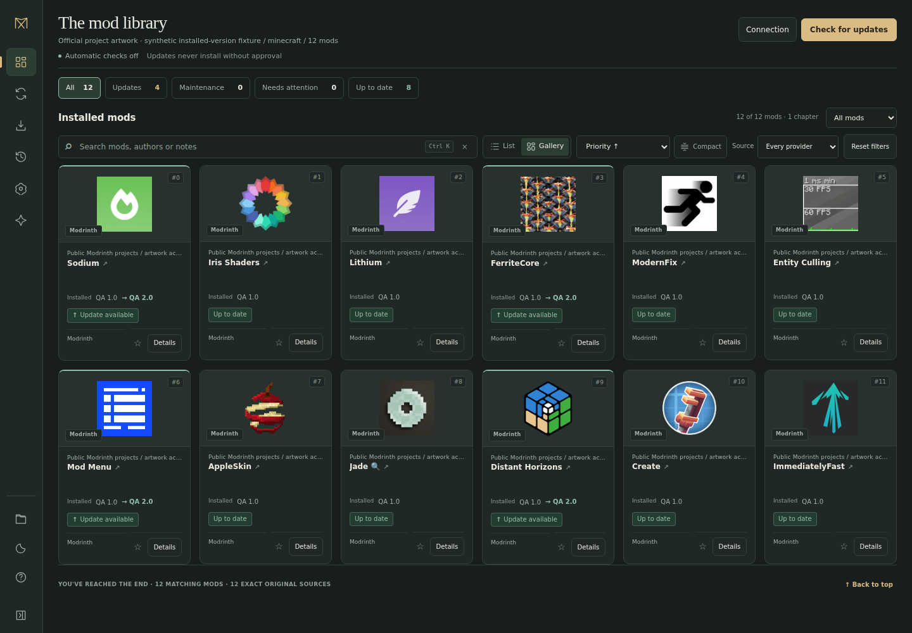
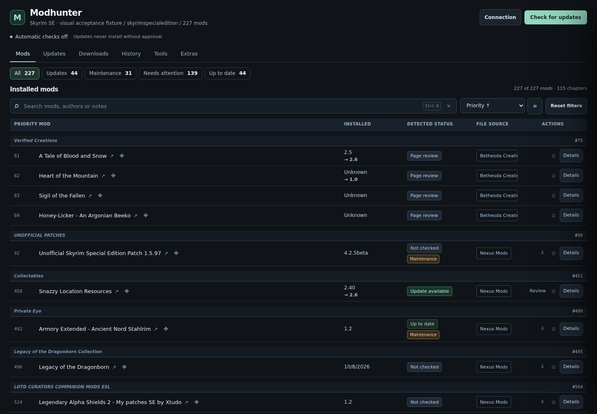
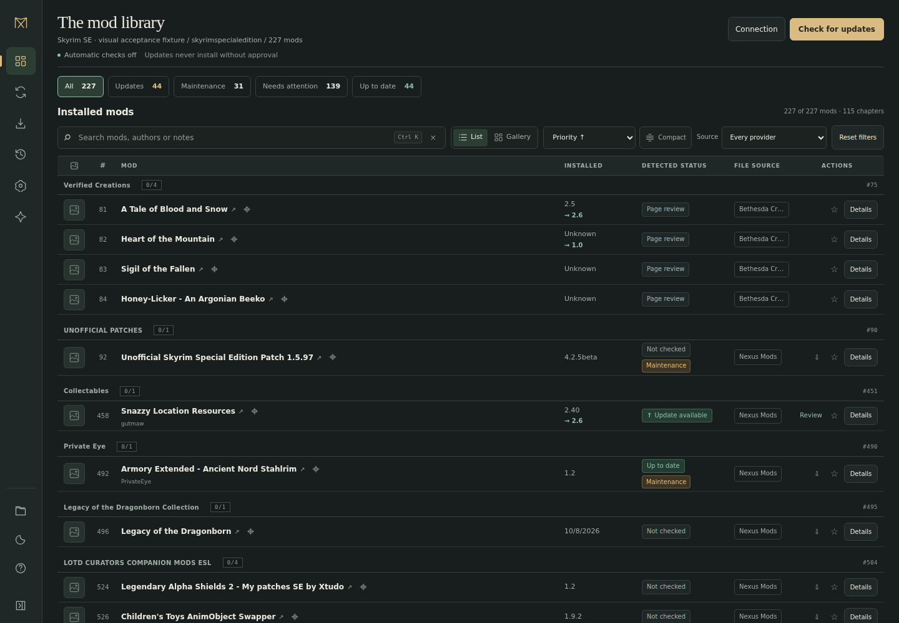
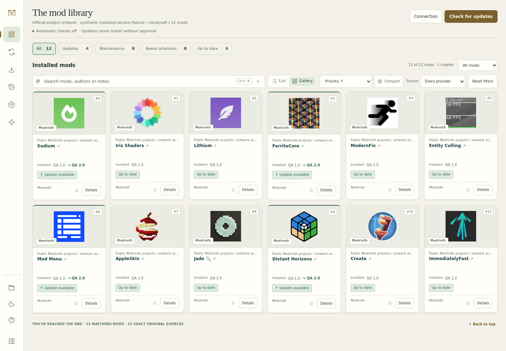
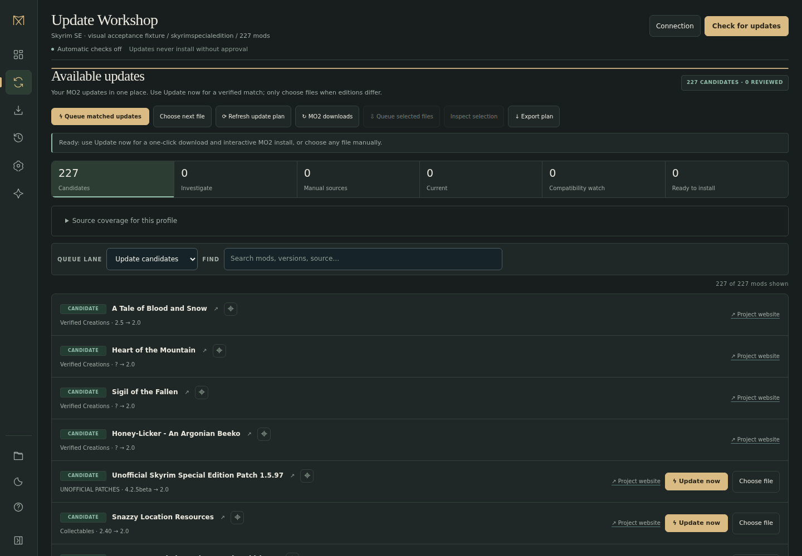

# Atelier 0.12 / The Mod Vault

> Historical v0.12.0 design and verification record. For the current build and setup instructions, use [Daily use](Daily-Use) and [MO2 Instances](MO2-Instances).

[Home](Home) · [Design standard](Design-System-and-Quality-Bar) · [Rust desktop](Rust-Desktop) · [Update Workshop](Update-Workshop) · [Watchtower](Watchtower)

**Atelier 0.12 brings a compact List and image-forward Gallery to Modhunter's complete library, with coordinated dark and light themes across the Rust desktop and shared dashboard.** Review exact update evidence, keep your source and version context, and manage the same collection through the view that suits it.

**[Windows installer](https://github.com/Herbertofury/Modhunter/releases/download/v0.12.0/Modhunter_0.12.0_x64-setup.exe)** · **[Portable Windows app](https://github.com/Herbertofury/Modhunter/releases/download/v0.12.0/Modhunter-Rust-Windows.zip)** · **[Release and all components](https://github.com/Herbertofury/Modhunter/releases/tag/v0.12.0)**

*Actual dashboard capture. Project names and artwork come from official public records; displayed installed versions and update states are deterministic test fixtures.*

## Your library, with more control over the view

The left navigation opens **Library**, **Updates**, **Downloads**, **History**, **Tools** and **Adventures**. Expand the rail when you want labels, or keep it compact to make more room for your collection. **Collections** opens the existing searchable chapter list. On a narrow window the workspace destinations become a compact top row.

The active profile and connection state remain above the library. A demonstration catalog is labeled as a demonstration; an imported profile is read-only; a disconnected profile retains its last known information. The **Connection** control explains the current state rather than pretending that offline data is live.

| Control | What it does |
| --- | --- |
| **List** | Compact rows with preview, name, installed/observed versions, detected status, source and real actions |
| **Gallery** | Image-forward cards built from the same complete mod records, with version/status context and Details |
| **All mods / By chapter** | In Gallery, choose a continuous globally sorted collection or retain chapter headers and their saved collapse state |
| **Compact / Comfortable** | Changes spacing and, in Gallery, card size without dropping records |
| **Source** | Filters the current library to an actual provider or source state; the option reports its count |
| **Search** | Searches names, authors, versions, notes and existing source/health evidence |
| **All / Updates / Maintenance / Needs attention / Up to date** | Narrows the library using the current detected evidence |
| **Reset filters** | Clears library search, status, source and health filters |
| **Details** or the preview | Opens the existing mod inspector and its real source, notes and compatibility controls |
| Right-click or **Shift+F10** on a mod control | Opens contextual Details, source, bookmark and applicable file/MO2 actions |

Text search retains qualified terms such as `author:`, `version:`, `note:` and `provider:`. **Ctrl+K** returns to the library and focuses search. The full library remains available: no result cap or viewport virtualization is used. Changing view or density preserves surviving row objects instead of rebuilding the catalog or repeating a provider scan.

Gallery defaults to **All mods**, so small chapters do not leave most of a row empty. Every matching record appears, including records in chapters you previously collapsed. Chapter labels stay on the cards and in Details. **By chapter** restores the saved chapter organization; returning to List keeps the same saved collapsed chapters. Priority, Name and Installed version sort globally in All mods and within chapters in the organized views. **J / K** follows the displayed order. Selecting a chapter through Collections opens the organized view and reveals that chapter.

A source filter stays active until changed or reset. Explicit chapter navigation and **Next pending** clear conflicting library filters so the requested target is actually revealed. Presentation preferences persist with the profile, including in the MO2 Chronicle. They do not alter enabled mods, installed files, load order or earned rewards.

## Real artwork, honest absence

A mod picture appears when the exact provider record supplies it. Current compact records carry Nexus project pictures, Modrinth gallery images/project icons and Thunderstore package icons. Gallery images fill their image area; icons retain their proportions. The frontend and native policy restrict these previews to the supported public CDN hosts.

The application does not guess a thumbnail from a filename or use a creator's portrait as mod artwork. **No preview supplied** is an intentional fallback. Failed images leave the card's name, source, versions and controls intact. Images decode asynchronously and use normal browser image loading; every mod remains in the result set whether its image is loaded or not.

The original source link remains the authoritative way to inspect the project. A beautiful thumbnail does not establish file compatibility, ownership, an authenticated session or installation permission.

## Updates remain the main operation

**Check for updates** uses the existing source-checking owner. **Updates** opens the revised Workshop with compact status counts, useful lanes, exact versions, source links, reviewed file selections and real download/installation states.

The existing rules remain in force:

1. Confirm the active profile and inspect the observed release evidence.
2. Review an exact file when the edition, runtime or archive is ambiguous. A version change alone does not authorize installation.
3. Approve the existing download/install workflow. MO2 retains its supported Nexus authentication and native installer, including FOMOD decisions.
4. Preserve the actual backup and verify the resulting installation. Use the existing guarded recovery workflow if restoration is required.

The appearance does not change queue authority, profile generations, cancellation, stale-result rejection, backup ownership or rollback rules. A context menu opened for an older catalog closes before it can act on a replacement profile. Watchtower source-page changes remain separate from verified compatible releases.

## Appearance and adventures

Dark mode uses warm charcoal and oxidized green; light mode uses parchment and warm white. Brass identifies the primary action. Status is written in text as well as color. Shared controls, the native shell, Watchtower and preference surfaces use the same material and type language.

**Appearance** switches the theme; a narrow window exposes the same action in its header. In the Rust desktop this shortcut updates the native appearance preference and waits for its acknowledgement, keeping the shell, dashboard and Watchtower consistent after profile imports. Native preferences also offer **System**. Standalone HTML retains its independent local theme preference. Keyboard outlines and reduced motion remain supported. Comfortable density is available when larger spacing is more useful than maximum rows.

**Adventures** retains Questbound, AetherFX/FX Studio, Shiverfell, Mythforge, Siege and Atlas. Their individual visual identities, progression, saves and customization remain intact. Maintenance stays available without playing a game, enabling effects or connecting Watchtower.

## Design reference

We studied the official [Sims 4 Mod Manager](https://gametimedev.de/S4MM/) and [tabs documentation](https://s4mm-wiki.gametimedev.de/en/how-to-use/tabs). Its image-forward grouping and compact controls informed the layout work. Modhunter's source evidence, version comparison, reviewed-update workflow and fantasy identity remain its own. The [official historical gallery screenshot](https://www.gametimedev.de/images/screenshot.png) used for composition study is labeled Alpha v0.1; it is not presented as the current version or a measured competitor benchmark.

## Actual before and after

These are original runtime captures of the same 227-mod catalog. The v0.11.0 comparison uses commit `1a99a66d346b1593273afc7c2b12e2d493c8d5e0`; the released capture uses `0f2d399244dbe0cc69e82521c497f006832678c3`. Source URLs and mod names are retained, while operational states are controlled fixtures. The screenshots are not mockups or generated artwork.

### v0.11.0 Library

### Atelier Library

The compact desktop row remains 48 pixels high. In the final same-run comparison, the first row moved from 352.8 to 313.2 pixels at a 1440-pixel width, and from 348.8 to 341.7 at 900 pixels. At 390 pixels, rows became 64 instead of 76 pixels high; the extra controls place the first row 18 pixels lower. These are measured fixture layouts, not a promise of the same visible-row count for every profile.

### Light theme and update review

[Inspect the narrow light Library](https://raw.githubusercontent.com/Herbertofury/Modhunter/baa123997577cba697d3ac991ac6090a0ecb2159/screenshots/v0.12.0/library-narrow-light.png) · [Exact-file review at narrow width](https://raw.githubusercontent.com/Herbertofury/Modhunter/baa123997577cba697d3ac991ac6090a0ecb2159/screenshots/v0.12.0/exact-file-narrow-light.png) · [Actual Windows desktop](https://raw.githubusercontent.com/Herbertofury/Modhunter/baa123997577cba697d3ac991ac6090a0ecb2159/screenshots/v0.12.0/native-desktop-dark.png) · [FX Studio and the preserved adventures](https://raw.githubusercontent.com/Herbertofury/Modhunter/baa123997577cba697d3ac991ac6090a0ecb2159/screenshots/v0.12.0/fx-studio.png)

## Verification and performance

Release **v0.12.0** packages commit [`0f2d399244dbe0cc69e82521c497f006832678c3`](https://github.com/Herbertofury/Modhunter/tree/0f2d399244dbe0cc69e82521c497f006832678c3) from [main-branch run 43947174658](https://github.com/Herbertofury/Modhunter/actions/runs/43947174658). The [Verification archive](https://github.com/Herbertofury/Modhunter/releases/download/v0.12.0/Modhunter-0.12.0-Verification.zip) preserves selected runtime receipts, build identities and screenshots. The [public checksum manifest](https://github.com/Herbertofury/Modhunter/releases/download/v0.12.0/SHA256SUMS.txt) covers the release files; downloaded installer, portable and component bytes were checked against the tested build. Full browser/visual captures remain with the linked workflow artifacts.

| Surface | Final release evidence |
| --- | --- |
| Source and lifecycle contracts | 280 Rust tests; 489 Python cases with 29 environment-specific skips, followed by the required actual-browser suites; 51 frontend runtime cases and 43 release-validator self-tests |
| Shared Gallery and native-manager browser fixtures | 19 Gallery and 20 native-manager actual Chromium cases; no skipped manager cases |
| Before/after visual comparison | 112 original screenshots, exact source hashes and the complete 11,207-record comparison |
| Font and preview edges | Eight real Chinese-heading glyphs, six dashboard/game font probes and six alpha/failed-preview captures verified; the installation shield and Expedition timer fixes were inspected in actual final captures |
| Actual Windows WebView2 desktop and Watchtower | 16 connected desktop, 26 Watchtower and 16 complete-library checks; all nine fixed performance ceilings, six Qt forward-runtime checks and 26 archive-review checks passed |
| Production plugin inside official MO2 2.5.2 | 30 separate native-fixture checks and 31 connected-desktop fixture checks, including exact archive installation, verification and complete content restoration |
| Exact installer | 15 actual install, installed-launch and uninstall checks; installed and portable executable bytes match |
| Published downloads | All six direct downloads returned HTTP 200; sizes, published SHA-256 digests, internal checksum manifests, all four archive build identities and the tested/installed executable matched |

### Complete-library timings

The benchmark imports the complete 11,207-record renderer fixture, searches its exact last item, restores every result, and uses the real List/Gallery/density controls. Matching rows are not capped or virtualized, and content-visibility skipping is not used. The fixture SHA-256 is `afd855e4ac76f284630ffb4ed6d9dc37280113c9559aef4402516795b7fef0a0`.

| Operation | Final Windows WebView2 sample |
| --- | --- |
| Complete renderer import | 3.656 s |
| Exact last-item search | 0.584 s |
| Restore the full search result | 2.392 s |
| List density change | 1.838 s |
| List → Gallery | 4.465 s |
| Gallery density change | 3.528 s |
| Gallery → List | 3.371 s |

Native measurement environment: **Edge WebView2 156.0.4314.58**, **1028 × 633 pixels, DPR 1**, **normal motion, light theme, visible foreground window**, one raw sample from the final main run. All 16 complete-library runtime checks and the fixed publication ceilings passed; each view/density endpoint restored ordinary hover feedback within the measured two-frame boundary. These renderer timings exclude Rust filesystem import, provider/network I/O and installation. Large complete-library changes still take measurable work; the results are not timing guarantees for another computer.

The same-run Linux browser comparison remains separately recorded in `visual/visual-release.json`. It uses three measured rounds with alternating baseline/candidate order. Different viewport, motion and hardware prevent treating browser and Windows numbers as a cross-runtime speedup comparison. Diagnostic history, including rejected performance experiments, remains in the repository's [motion evidence](https://github.com/Herbertofury/Modhunter/blob/0f2d399244dbe0cc69e82521c497f006832678c3/native/evidence/atelier-motion-diagnostics-0.12.0.json) and [followup evidence](https://github.com/Herbertofury/Modhunter/blob/0f2d399244dbe0cc69e82521c497f006832678c3/native/evidence/atelier-followup-diagnostics-0.12.0.json).

### What these checks do not establish

The runtime suites use owned fixtures. They do not establish the user's personal MO2 beta installation, authenticated Nexus account/download behavior, arbitrary FOMOD choices or in-game compatibility of a particular collection. Real source-page observations are separate from verified compatible releases; browser sign-in never becomes a provider API grant. Offline checklist actions remain practice and cannot award verified-update progression.

## Download and build identity

| Asset | Direct download |
| --- | --- |
| Windows installer | [Modhunter_0.12.0_x64-setup.exe](https://github.com/Herbertofury/Modhunter/releases/download/v0.12.0/Modhunter_0.12.0_x64-setup.exe) |
| Portable Windows package | [Modhunter-Rust-Windows.zip](https://github.com/Herbertofury/Modhunter/releases/download/v0.12.0/Modhunter-Rust-Windows.zip) |
| Independent MO2 components | [Modhunter-0.12.0-MO2-Plugin.zip](https://github.com/Herbertofury/Modhunter/releases/download/v0.12.0/Modhunter-0.12.0-MO2-Plugin.zip) |
| Standalone dashboard and games | [Modhunter-0.12.0-Standalone.zip](https://github.com/Herbertofury/Modhunter/releases/download/v0.12.0/Modhunter-0.12.0-Standalone.zip) |
| Runtime proof and build identity | [Modhunter-0.12.0-Verification.zip](https://github.com/Herbertofury/Modhunter/releases/download/v0.12.0/Modhunter-0.12.0-Verification.zip) |
| Public checksums | [SHA256SUMS.txt](https://github.com/Herbertofury/Modhunter/releases/download/v0.12.0/SHA256SUMS.txt) |

The portable and component archives retain `BUILD_INFO.json`; the standalone package opens as `Modhunter.html`. The public download readback binds their build identity, archive checksums and installed executable to the release commit. The [documentation workflow](https://github.com/Herbertofury/Modhunter/actions/workflows/sync-wiki.yml) mirrors the repository Wiki pages to the live GitHub Wiki.
