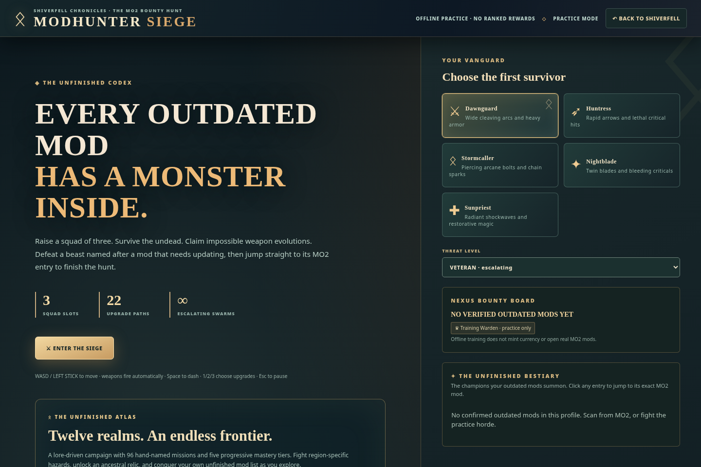
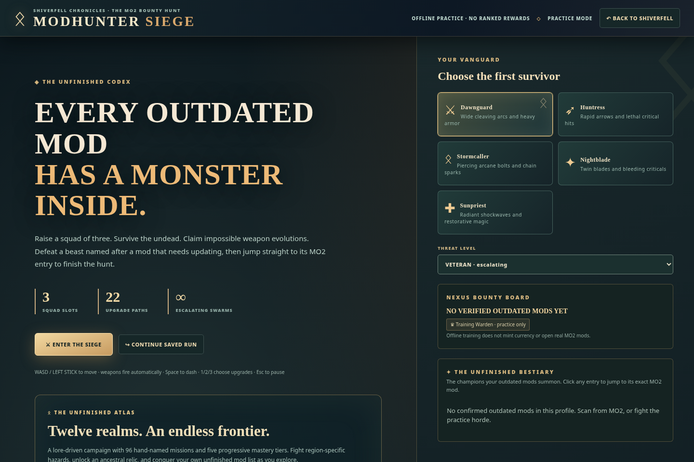

# 🗺️ The Atlas Campaign
[Home](Home.md) / Atlas

The v0.8 Atlas contains **12 regions**, each with **8 authored chapter contracts**, playable across **5 mastery tiers**. That gives **96 named contracts** and **480 first-clear conditions**.

The mastery tiers expand challenge without pretending to constitute hundreds of individually playtested story chapters. The source catalogue describes a base timer total of 80 hours across tiers, **not** a verified average gameplay duration.

### Progression
Complete a contract objective, survive its environmental hazard and defeat or avoid the designated threat. Higher mastery tiers unlock harder variants and first-clear progression. Permanent Legacy perks use **game-only Embers** rather than pretending to award official MO2 Forge Sigils.

### Continuity
Standalone HTML, desktop and MO2 browser dashboard load the same game family. Connected official maintenance rewards remain controlled by MO2; local game progress remains playable offline.
