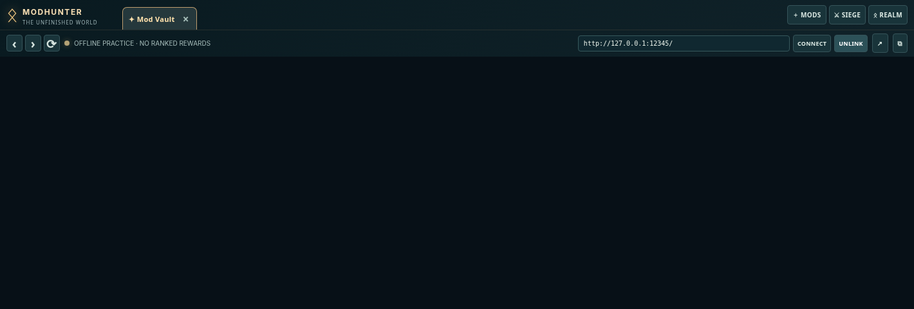

# 🖥️ Desktop App
[Home](Home.md) / Desktop

The Electron desktop provides dedicated Chromium tabs for the **Mod Vault**, **Modhunter Siege**, and **Shiverfell**. The source package runs standalone, with no MO2 installation necessary for offline play, and **can import a real MO2 profile without installing the Modhunter plugin**.

1. Download [desktop source](https://github.com/Herbertofury/Modhunter/blob/main/dist/Modhunter-Desktop-Source.zip).
2. Extract and read `desktop/README.md`.
3. Install compatible Node.js and project dependencies.
4. Run `desktop/Run_ModHunter.bat` on Windows.
5. For offline mod inspection, click **⌁ Import MO2** in the top bar and select the real `profiles/<your profile>/modlist.txt` file from a portable MO2 instance. Modhunter imports installed versions, Nexus IDs, local URLs, enabled state, and DLL warnings, retaining even mods not present in the selected profile.
6. Optionally paste the session URL from the MO2 plugin into **Connect** to unlock verified remote scans and native downloads.

**Runtime proof:** the recovered baseline reports Chromium tab interaction and JavaScript syntax passing. Native Windows Electron packaging remains unverified; this is **source**, not a prebuilt Windows EXE.

**Offline import details:** No MO2 Python plugin, API key or background watcher is needed. The import is read-only, saved locally in the desktop app and reloaded on future launches. Re-import when the modlist changes. Imports require `profiles/` and `mods/` together in one MO2 instance directory; split-path/global installs should use the live plugin. The desktop app does not write into or install mods directly.
