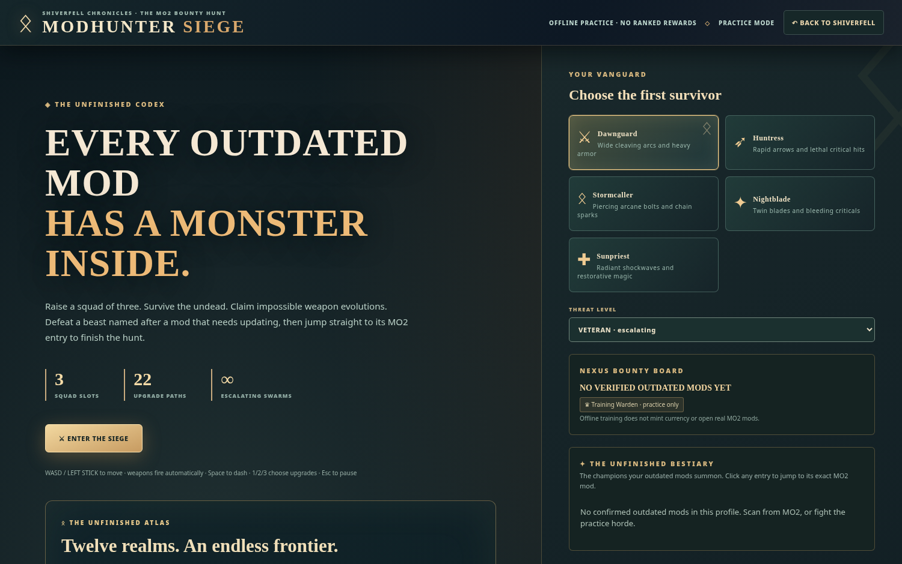

# ⚔️ Game Modes
[Home](Home.md) / Modes

## Modhunter Siege
A survivor-style combat roguelite with **5 hero classes**, automatic attacks, **22 upgrade paths**, **6 evolutions**, timed bosses and mod-themed enemies. Installed outdated mods can become in-world bounties only in a connected MO2 session.

## Atlas Campaign
**12 regions × 8 contracts × 5 mastery tiers = 480 first-clear milestones.** Missions carry distinct objectives, hazards and lore. See [Atlas Campaign](Atlas-Campaign.md).

## Shiverfell
A top-down persistent survival world with exploration, resource gathering, crafting, quests, weather, companions and the Dawnshard world-boss storyline. Offline saved game progress is separate from MO2 authorized maintenance rewards.

## Update Arsenal
The practical mod-management interface: current profile inspection, update candidates, versions and supported download/install operations, with gamification tied to verified actions.
