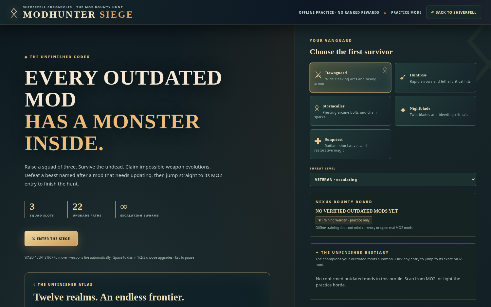

# ⚔️ Game Modes
[Home](Home.md) / Modes

## Modhunter Siege
A survivor-style combat roguelite with **5 hero classes**, automatic attacks, **22 upgrade paths**, **6 evolutions**, timed bosses and mod-themed enemies. Installed outdated mods can become in-world bounties only in a connected MO2 session.

## Atlas Campaign
**12 regions × 8 contracts × 5 mastery tiers = 480 first-clear milestones.** Missions carry distinct objectives, hazards and lore. See [Atlas Campaign](Atlas-Campaign.md).

## Shiverfell
A top-down persistent survival world with exploration, resource gathering, crafting, quests, weather, companions and the Dawnshard world-boss storyline. Offline saved game progress is separate from MO2 authorized maintenance rewards.

## Update Arsenal
The practical mod-management interface: current profile inspection, update candidates, versions and supported download/install operations, with gamification tied to verified actions.

## Roaming creature reward POIs — approved goal, not implemented (2026-11-19)

Add optional moving points of interest on large creatures: airborne birds and eventually colossal roaming giants. Reach an attached, clearly marked object by platforming/climbing, then **hit that object to collect a substantial in-game XP/points reward**. The intended feel mixes playful traversal with roguelite run decisions, especially Megabonk-like experiences; Shadow of the Colossus is a scale/climbing inspiration, not permission to copy characters, art or code. This records a requested goal, not verified capabilities of either reference game.

- [ ] Reconcile existing movement, moving-platform collision, creature rigs, reward ledgers and run lifecycle before implementation; research reusable existing solutions first.
- [ ] Prototype one optional slow ground giant with a marked reward object, two approach routes, safe exit and seed-varied route placement. Reuse suitable authorized assets/data for variation without treating reuse as a ceiling on quality or new features.
- [ ] Make boarding, movement-relative footing, climbing/jumping, hit registration and payoff legible and fun; provide reachable alternatives for differing mobility/builds and accessibility needs. Missing an optional encounter must not block a run.
- [ ] Define meaningful high rewards balanced against time, traversal difficulty and combat risk. Commit one reward per stable run/creature/object identity; repeated hits, reconnect, reload and overlapping collection must not duplicate it.
- [ ] Test missed jumps, safe recovery, camera/readability, creature bounds/despawn, pause/death/restart, simultaneous collection where multiplayer exists, and low/high mobility. Preserve saves, unrelated world/player state and prior progression.
- [ ] Record exact-build performance and actual player enjoyment/playtests; expand to flying creatures and larger multi-stage giants only after the bounded first slice works. Do not mark the goal complete from a mockup, menu, static giant or simulated reward alone.

**Modhunter scope:** track separately for Siege and Shiverfell's roguelite modes, adapting traversal to each mode's actual camera/movement rather than claiming existing 3D climbing. Preserve earlier moving geode-node worms, loot goblins, side-run return continuity and run-duration choices. Collected rewards are game-only XP/run points, never verified mod-update rewards, Forge Sigils, automatic installation or penalties for pinned mods. Keep the practical updater unaffected.

## Long-horizon progression, resources and themed bases — goal only (2026-11-19)

**Owner direction, not implemented or measured playtime:** collect spendable resources such as gold, make between-run upgrades and home/castle building meaningful, and treat roughly the first 100 hours as the beginning rather than the end. Later progression should reveal genuinely new abilities, characters, maps, enemy families and bosses. Support multiple themed bases with resource storage and an eventually scalable open-world mode. Challenge and satisfying new decisions must continue; procedural reshuffling and inflated statistics alone do not meet this goal. The 100-hour figure expresses ambition, not a mandatory wait before fun features or a promise of existing content.

**Reference evidence:** the [official Night Swarm Steam page](https://store.steampowered.com/app/3668370/Night_Swarm/), checked 2026-11-19, describes a castle hub with NPC talent/item shops, gold exchanged at totems, companions and large bosses. This is publisher description, not hands-on verification. It does **not** establish the requested multi-base construction/storage, open world or 100-hour-plus depth; those are the owner's proposals.

- [ ] Audit existing resource/currency, persistence, crafting, base/home and unlock systems; reuse compatible code and authorized assets without reducing quality or preventing genuinely new mechanics.
- [ ] Define distinct run resources and retained resources, explicit earn/spend rules, visible costs and upgrade effects, refunds/respec where suitable, and fair death/abandonment handling. Make one end-to-end earn → return → spend → visibly improved next-run loop playable first.
- [ ] Design home/castle construction as meaningful choices and usable facilities, not a decorative menu or a wall of percentage bonuses. Define ownership, building costs, resource storage and clear progression purpose.
- [ ] Plan staged discoveries with new verbs/build synergies, characters, authored map features, enemy behaviors and boss mechanics. Preserve early accessibility and optional paths; do not gate basic enjoyment behind 100 hours of grind.
- [ ] Extend to multiple themed bases with distinct functions, safe travel/return and explicit storage/transfer rules. Test transaction interruption, concurrent actions, duplication, capacity/overflow, migration and backup/recovery without losing items or existing saves.
- [ ] Prototype a scalable open-world mode separately, with streaming/persistence, encounter scheduling, bounded active simulation and measured frame/memory/save budgets. Preserve distinct run-based modes; do not claim an infinite world or unlimited performance from procedural generation.
- [ ] Prove sustained challenge, meaningful upgrade tradeoffs, late-game novelty and player enjoyment through exact-build playtests across early/mid/late progression. Use accelerated progression tests for correctness but not as proof of 100 hours of authored enjoyment. Keep all milestones open until implemented and accepted.

**Modhunter adaptation:** reconcile Siege's run progression separately from Shiverfell's persistent survival/crafting world and roguelite modes. Preserve earlier companion/boss, geode-worm, goblin, portal-return and run-duration requirements. Gold/base resources are game-only, not fabricated verified MO2 update rewards or Forge Sigils. Never install/update mods automatically, penalize pinned mods or block practical mod management behind gameplay.

## Run-unique world discoveries and faction warzones — open goals (2026-11-19)

**Owner direction, not implemented:** make each run richly explorable, with meaningful discoveries rather than empty procedural repetition. As players gain movement capabilities and travel faster or farther, reveal new biomes, distinct enemies, caves, homes, companions and unexpected bosses. Include faction warzones where enemies fight each other and the player can choose to enter. Support satisfying **30-, 60-, 90-minute and endless** experiences without deleting previously requested duration choices. Seed changes or higher enemy statistics alone do not satisfy this goal.

- [ ] Audit existing world generation, authored encounters, movement unlocks, faction AI, run lifecycle and save systems before adding parallel systems. Reuse authorized assets creatively while adding genuinely different interactions, routes and decisions.
- [ ] Define biome identities through traversal, hazards, enemy behavior, resources and discoverable stories, not palette swaps alone. Connect increased speed/range to reachable discoveries, with clear route clues and alternatives for different builds; avoid long empty travel or making low-mobility builds nonviable.
- [ ] Build a first playable discovery chain spanning contrasting regions: an explorable cave or home, a companion opportunity, and a surprising but readable optional boss. Give discoveries consequences, useful choices and safe return/exit rather than empty scenery or unavoidable ambushes.
- [ ] Add faction-versus-faction encounters with readable allegiances, distinct tactics and meaningful player choices to observe, intervene or leave. Specify targeting, aggro transfer, victory consequences, rewards and persistence; prevent offscreen combat, repeated entry or faction kills from duplicating player rewards.
- [ ] Design separate pacing arcs for 30/60/90-minute and endless runs: early discoveries, intermediate changes, later biome/encounter combinations and satisfying conclusions or voluntary exits. Do not simply stretch the same wave schedule. Preserve earlier duration options and portal side-run return continuity where applicable.
- [ ] Combine authored encounter families with seed-aware placement, recent-discovery tracking and variation that changes gameplay. Avoid promises of literally limitless unique content; endless mode needs meaningful ongoing choices and transparent repeat behavior.
- [ ] Test unreachable layouts, high-speed streaming, cave/home entry and return, encounter overlap, faction targeting, companion persistence, unexpected-boss fairness, save/reload and duplicate rewards. Measure frame time, memory and active simulation at long distances and long run durations.
- [ ] Playtest actual short/medium/long/endless builds for discovery density, repeated-content fatigue, travel downtime, risk/reward and enjoyment. Automated seed sweeps or accelerated timers prove correctness only, not satisfying hours of gameplay. Keep implementation and acceptance milestones open until evidenced.

**Modhunter adaptation:** Reconcile Siege and Shiverfell separately, respecting their actual cameras, movement and persistent/run-based state. Preserve earlier 10/20/30/60/120-minute choices and endless goals; 90 minutes is an addition. Keep game encounter rewards separate from verified MO2 maintenance/Forge Sigils, pinned mods and installation decisions; practical mod management must remain unaffected.
