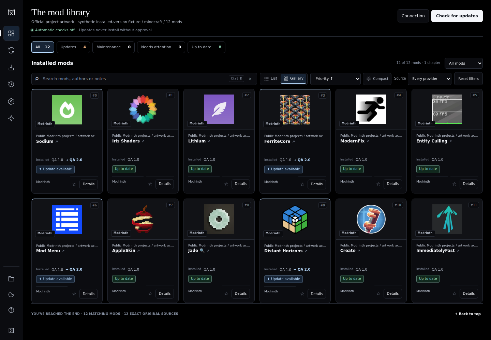

# ⚔️ MODHUNTER
### THE UNFINISHED WORLD

**Browse your mods · Review every update · Keep your world intact**

*Actual shared-dashboard capture. Public project names and icons are authentic; installed versions and update states are test fixtures.*

> **Welcome to the Mod Vault.** Browse your complete collection, review exact sources and files, and keep verified backups when installing updates. Your unfinished world still holds quests, battles and rewards when you want to explore it.

| Choose an entry point | Requirement | Optional connection |
| :-- | :-- | :-- |
| **[Rust Desktop](Rust-Desktop.md)** | Windows and WebView2; installer or portable app | Find MO2 for live updating |
| **[MO2 Plugin](MO2-Plugin.md)** | Mod Organizer 2 | Desktop or browser |
| **[Standalone HTML](Standalone-HTML.md)** | A modern browser | MO2 local bridge |

**[MO2 2.5.3b12 / Skyrim SE testing](MO2-253-Testing.md)** | **[GameSync update-checking technique map](GameSync-Update-Techniques.md)**

## Library and updates

**[Daily use and setup](Daily-Use)** · **[OLED 0.12.1 verification](OLED-0.12.1)**

**[Windows installer](https://github.com/Herbertofury/Modhunter/releases/download/v0.12.1/Modhunter_0.12.1_x64-setup.exe)** · **[Portable package](https://github.com/Herbertofury/Modhunter/releases/download/v0.12.1/Modhunter-Rust-Windows.zip)** · **[Release, components and checksums](https://github.com/Herbertofury/Modhunter/releases/tag/v0.12.1)** · **[Atelier guide](Atelier-0.12)**

The workspace offers an image-forward gallery, compact and comfortable list views, provider filtering, a collapsible navigation rail and coordinated OLED-black and neutral-light themes. Real source artwork appears when the exact mod record supplies it. The complete library, reviewed update workflow, backup and recovery controls, and every existing adventure remain available. See the [0.12.1 guide](OLED-0.12.1) for current screenshots, corrected chapter progress, readiness checks and release verification; the [Atelier guide](Atelier-0.12) records the original design comparison.

Release **v0.12.1** uses commit [`f96b86969ec9f9c7ba6928284f16223b673d33c0`](https://github.com/Herbertofury/Modhunter/tree/f96b86969ec9f9c7ba6928284f16223b673d33c0), tested in the [final main-branch workflow](https://github.com/Herbertofury/Modhunter/actions/runs/43992734962). [Get started](Getting-Started) with a read-only profile import, then connect MO2 when you want live update operations.

The current desktop uses Rust for the shell, parallel profile importer, metadata cache, native operations and MO2 discovery. The shared dashboard and complete games continue in WebView2; MO2's Python adapter retains its native Nexus/download/install integration. Earlier combined archives below preserve the previous Electron release series.

**[Earlier Everything Combined archive](https://drive.google.com/file/d/1UZzjHQQX3hceSWcJWFX2yygH6htzXqHE/view)** · **[Legacy All-in-One archive](https://github.com/Herbertofury/Modhunter/blob/main/dist/Modhunter-All-in-One.zip)** · **[Unified guide](Unified-Modhunter.md)**

Keep the real MO2 load order updated first. The combined interface includes the complete **Update Workshop**, **Questbound**, **AetherFX**, **Shiverfell**, **Mythforge**, **Modhunter Siege**, and **Atlas**, alongside the original 36-file historical archive. Each of the HTML, Desktop and MO2 plugin editions can launch independently. The live MO2 updater is the optional authoritative connection when verifying/queueing/installing updates.

## 🌌 The realms

| Game | Identity |
| :-- | :-- |
| **Modhunter Siege** | Survivor roguelite with 5 classes, 22 upgrades, 6 weapon evolutions and boss fights |
| **Atlas Campaign** | 12 regions, 96 authored contracts, 5 mastery tiers, 480 first-clear milestones |
| **Shiverfell Chronicles** | Persistent top-down exploration, crafting, weather, companions and quests |
| **Update Workshop** | Full MO2 profile audit, native Nexus connection, Rust GitHub/GitLab/Modrinth/Thunderstore adapters, exact-file downloads and interactive MO2 installs |

## ✧ Craft standard

**[Modhunter Design & Quality Standard](Design-System-and-Quality-Bar)** defines the updater-first information hierarchy, OLED-black utility palette and authored colored chapters, restrained motion, accessible navigation, deliberate microcopy, and a strict no-clutter/no-feature-loss acceptance checklist. Shared UI changes must meet the same standard in portable HTML, desktop and MO2.

## 📖 Field guide

**[Complete Original Release Vault](Original-Releases-and-Output-Audit.md)** · **[Update Workshop](Update-Workshop.md)** · **[Updater Source Coverage](Updater-Source-Coverage.md)** · **[Getting Started](Getting-Started.md)** · **[Game Modes](Game-Modes.md)** · **[Atlas Campaign](Atlas-Campaign.md)** · **[Unfinished Bestiary](Unfinished-Bestiary.md)** · **[Rewards & Integrity](Rewards-and-Integrity.md)** · **[Architecture](Architecture.md)** · **[Troubleshooting](Troubleshooting.md)**

## 📦 Eight original releases. No missing historical ZIPs or GIFs.

**[Browse the authentic original-release vault](Original-Releases-and-Output-Audit.md)**, with every v0.1–v0.8 HTML, plugin/source archive, four original gameplay GIFs, the original victory PNG, original Atlas map, release manifests and latest checked update packages. [Download the complete 58 MB bundle from Google Drive](https://drive.google.com/file/d/1tQBnUZ_vDF7tUTtiXf8WJC41OEXNVG_5/view).

## A single world, three independent gateways

The standalone HTML carries the complete dashboard and games in a portable browser file. The desktop app uses Rust for its window and native operations, with WebView2 displaying the shared interface. The MO2 plugin owns live profile inspection and verified update rewards. Optional loopback communication allows them to share the same active game/profile identity without requiring any of the other installations.

**Release preservation:** all 36 original v0.1–v0.8 deliverables, including the authentic GIFs and historical source/plugin ZIPs, are recovered and SHA-256 audited. The [Rust release workflow](https://github.com/Herbertofury/Modhunter/actions/workflows/native-rust.yml) adds actual Windows application and MO2 fixture gates; its run receipts distinguish them from account-specific Nexus and FOMOD acceptance.
