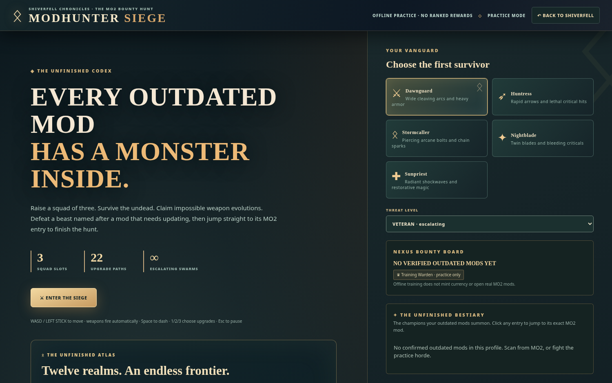

# ⚔️ MODHUNTER
### THE UNFINISHED WORLD

**Repair your load order · Hunt unfinished mods · Build a legend**

> **Welcome, Hunter.** Your unfinished mod list is more than a maintenance backlog. It becomes your bestiary, quests and battles.

| Enter the world | Standalone requirement | Optional link |
| :-- | :-- | :-- |
| **[Portable HTML](../web/Modhunter.html)** | A modern browser | MO2 localhost |
| **[Desktop App](Desktop-App.md)** | Node.js / Electron for source build | MO2 localhost |
| **[MO2 Plugin](MO2-Plugin.md)** | Mod Organizer 2 | Desktop or browser |

## 🌌 The realms

| Game | Identity |
| :-- | :-- |
| **Modhunter Siege** | Survivor roguelite with 5 classes, 22 upgrades, 6 weapon evolutions and boss fights |
| **Atlas Campaign** | 12 regions, 96 authored contracts, 5 mastery tiers, 480 first-clear milestones |
| **Shiverfell Chronicles** | Persistent top-down exploration, crafting, weather, companions and quests |
| **Update Arsenal** | Check installed mods, inspect candidates, launch MO2-supported update actions |

## 📖 Field guide

**[Getting Started](Getting-Started.md)** · **[Game Modes](Game-Modes.md)** · **[Atlas Campaign](Atlas-Campaign.md)** · **[Unfinished Bestiary](Unfinished-Bestiary.md)** · **[Rewards & Integrity](Rewards-and-Integrity.md)** · **[Architecture](Architecture.md)** · **[Troubleshooting](Troubleshooting.md)**

## A single world, three independent gateways

The HTML is an entirely portable play surface. The desktop app is a dedicated multi-tab Chromium shell. The MO2 plugin alone owns live profile inspection and verified update rewards. Optional loopback communication allows them to share the same active game/profile identity without requiring any of the other installations.

**Development build:** Browser tests and 68 Python tests were completed in the recovered v0.8 checkpoint. Native Windows MO2 and Electron acceptance testing remain to be performed.
