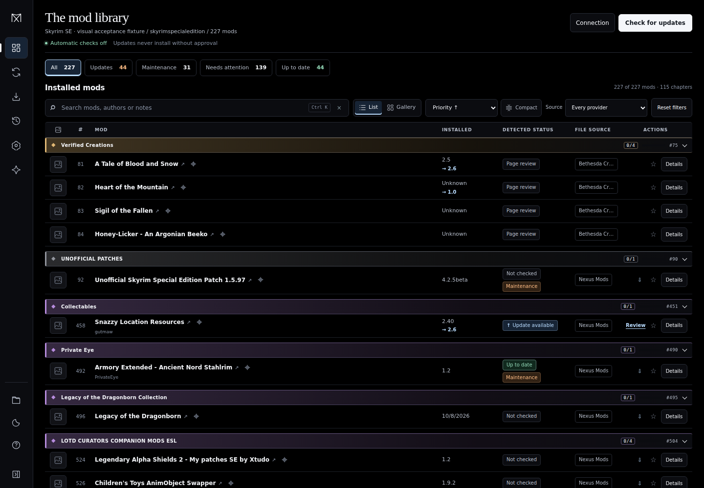
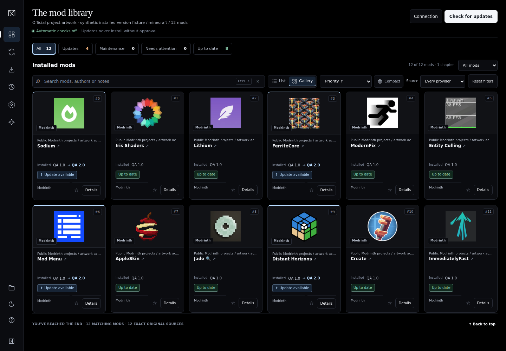
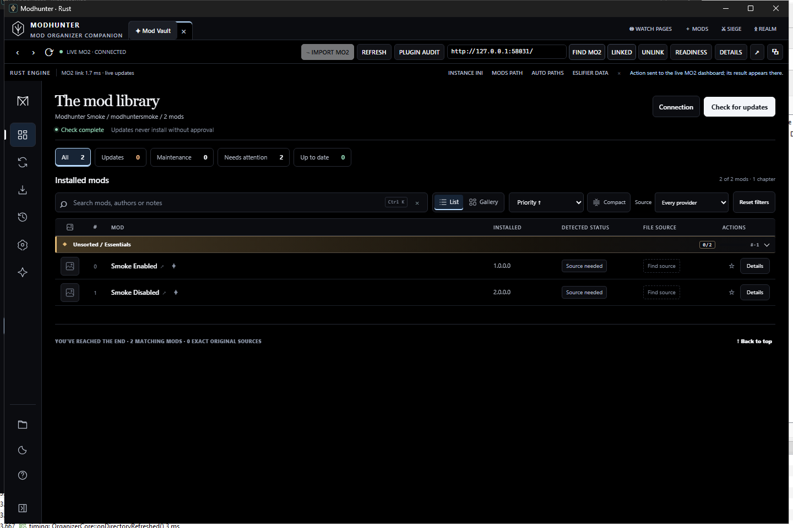

# OLED 0.12.1 / Daily-use release

[Home](Home) · [Daily use and setup](Daily-Use) · [Rust desktop](Rust-Desktop) · [MO2 readiness](MO2-253-Testing)

**Modhunter 0.12.1 is the published Windows release for everyday library browsing, source checks, reviewed updates and recovery.** It brings the OLED-black interface and colored chapters into the packaged desktop, corrects offline checklist progress, and makes the MO2 readiness checker follow the verified package version.

**[Complete portable Windows package](https://github.com/Herbertofury/Modhunter/releases/download/v0.12.1/Modhunter-Rust-Windows.zip)** · **[Windows installer](https://github.com/Herbertofury/Modhunter/releases/download/v0.12.1/Modhunter_0.12.1_x64-setup.exe)** · **[All components and checksums](https://github.com/Herbertofury/Modhunter/releases/tag/v0.12.1)**

The complete portable ZIP includes the desktop, matching MO2 plugin, plugin installer and readiness checker. Extract it into its own folder and follow [Daily use](Daily-Use). The separate desktop installer can install WebView2 when the runtime is missing.

## What changed

- **OLED black and visible feedback.** Neutral surfaces and cool white/blue controls carry through the shell, Library, Update Workshop, Watchtower, preferences and dialogs. Colored chapter bands, diamonds, selection, focus and operation feedback stay visible. Light mode retains the same controls.
- **Correct packaged chapter progress.** The native content-security policy blocked HTML inline styles, which could remove chapter colors and make an empty progress bar appear full. Chapter color and fill values now use explicit DOM style-property writes. Actual packaged and installed WebView2 launches verify the authored chapter color and an empty `0/3` bar; Chromium also checks distinct chapter colors, partial progress and complete progress.
- **Current-version MO2 readiness.** The checker reads the expected version from checksum-verified package metadata and verifies agreement with the bundled plugin. It no longer expects an old hardcoded release. Missing, mismatched, malformed or tampered package metadata produces a failed check before installation.
- **Less row-formatting overhead.** Compact rows no longer create eight whitespace-only formatting nodes each: 89,656 fewer nodes at 11,207 mods. Real field whitespace, escaping, controls and metadata remain intact. The complete list remains present and laid out; no records are capped or virtualized.

Manual checklist progress describes the checklist. Source evidence, an available update and a verified installation retain their separate meanings. The review, download, backup and recovery workflow is documented in [Daily use](Daily-Use) and [Update Workshop](Update-Workshop).

## Actual captures

*Actual shared dashboard using repository mod names and source links. Statuses are deterministic visual fixtures, not live provider verdicts.*

*Actual Gallery with authentic project names and artwork; installed versions and update states are labeled test fixtures.*

*The compiled Windows app connected to the actual MO2 fixture. Its two synthetic mods establish the native connection path; this image is not a personal populated profile.*

## Verified release identity

Release **[v0.12.1](https://github.com/Herbertofury/Modhunter/releases/tag/v0.12.1)** packages commit [`f96b86969ec9f9c7ba6928284f16223b673d33c0`](https://github.com/Herbertofury/Modhunter/tree/f96b86969ec9f9c7ba6928284f16223b673d33c0). All five jobs passed in [main-branch run 43992734962](https://github.com/Herbertofury/Modhunter/actions/runs/43992734962): contracts, MO2, visual, Windows and release publication.

The public readback downloaded all six release assets successfully, checked their GitHub digests and release manifest, verified complete internal checksum coverage in the portable/plugin/standalone packages, and reconciled their build identities with the verification archive. The independent MO2 files match the portable package byte for byte; the standalone dashboard matches its bundled counterpart. [Public download receipt](https://github.com/Herbertofury/Modhunter/blob/main/docs/evidence/public-release-readback-0.12.1.json).

| Item | SHA-256 |
| --- | --- |
| Portable ZIP | `b24fd6dba11a3fa96f09ed661ae333e9d56e46e3421f36d5498893feee8bd761` |
| Windows installer | `b776ea36a8174bd4a6369527dff2f3abd6f3efdd975bc4933b6984a188ea22e8` |
| Tested and installed executable | `25b9bc48e558c50b79bc843ce241e244e0fa758a1e47549f57243479939f2091` |
| Shared dashboard | `2742135183c9b68ad650a4b9fbf9dbda9ae1b79292dae40b9b81330669025422` |

The [verification archive](https://github.com/Herbertofury/Modhunter/releases/download/v0.12.1/Modhunter-0.12.1-Verification.zip) contains the runtime reports, exact build identity and screenshots. [SHA256SUMS.txt](https://github.com/Herbertofury/Modhunter/releases/download/v0.12.1/SHA256SUMS.txt) covers all four ZIP archives and the Windows installer.

## What the release gates exercised

| Gate | Observed result and scope |
| --- | --- |
| Source contracts | Rust tests and strict Clippy passed on Linux and Windows; Rust formatting passed in contracts; 134 JavaScript tests and 44 package-validator tests passed. The hosted Python discovery suite ran 489 tests with 29 prerequisite-dependent skips and no failures; dedicated browser, native and real-CLI archive/recovery/queue stages supplied their separate runtime checks. |
| Actual Chromium | Library, Gallery, search, density, source filters, profile lifecycle, update review, Watchtower, preferences and chapter progress passed. Visual acceptance produced 112 before/after screenshots across desktop/narrow and dark/light layouts. |
| Windows readiness and plugin installation | Windows PowerShell 5.1 checked package integrity, current/future version metadata, malformed/mixed/tampered packages, installation, upgrades and progress preservation. |
| Packaged and installed WebView2 | Both launches passed exact executable identity, native shell IPC, local profile import, chapter color/empty progress, backup download and game-content IPC isolation. |
| Exact NSIS installer | All 15 checks passed, including installation, resources, installed-app launch, current-user registration, uninstall and unchanged external fixture data. |
| Actual MO2 | Official MO2 2.5.2 loaded the production plugin and passed all 30 fixture checks, including the real loopback API, Qt bridge, native focus, Rust probe and an actual generated-archive install/restore. Wrong-target, later-edit and repeated-acknowledgement guards also passed. |
| Qt forward runtime | The packaged helper passed the separate Windows Qt 6.11.1 / PyQt 6.11.0 acceptance check. |
| Native Watchtower and archive tools | All 26 Watchtower checks and all 26 archive checks passed. These use controlled sources and do not establish every provider's account-specific behavior. |

## Complete-library Windows performance

The exact packaged executable ran a complete **11,207-record generated fixture** in **Edge WebView2 156.0.4314.58**. Every row remained present and laid out, ordered IDs matched, the last record was searchable, and all 16 runtime checks passed. These are one Windows CI sample's measured operations, not personal-installation timings or application cold-start measurements.

| Operation | Observed | Existing release ceiling |
| --- | ---: | ---: |
| Initial library render | 3,225.3 ms | 7,000 ms |
| Search for the last item | 517.2 ms | 1,500 ms |
| Restore the complete search result | 2,032.2 ms | 7,000 ms |
| Change List density | 1,267.3 ms | 4,000 ms |
| Reset List density | 1,182.8 ms | 4,000 ms |
| Open Gallery | 3,708.4 ms | 5,000 ms |
| Change Gallery density | 1,935.8 ms | 4,000 ms |
| Return to List | 2,500.9 ms | 5,000 ms |
| Final density reset | 1,318.0 ms | 4,000 ms |

The ceilings were unchanged. The raw report is `windows/native-library-performance.json` in the verification archive and is also included in the public download receipt.

### Controlled browser comparison

The [controlled follow-up passed](https://github.com/Herbertofury/Modhunter/actions/runs/43994923820). It compared the direct parent `2f1dfddbd92732f83fc145defd194d4b286bf8ec` with the released source on one four-logical-CPU Linux runner in Chromium 157.0.8103.0. The unchanged benchmark retained one excluded warmup pair, three alternating measured pairs and fresh contexts. All six measured samples retained 11,207 complete, ordered, laid-out rows and preserved the surviving row through search, restoration and sorting.

| Operation | Direct parent median | Released source median | Change |
| --- | ---: | ---: | ---: |
| Import and render | 5,010.5 ms | 4,654.9 ms | −7.1% |
| Last-item search | 615.8 ms | 600.4 ms | −2.5% |
| Sort | 3,503.9 ms | 3,473.4 ms | −0.9% |
| Navigate to Updates | 1,804.5 ms | 1,785.8 ms | −1.0% |
| Navigate to Library | 2,951.6 ms | 2,927.2 ms | −0.8% |
| Change List density | 1,986.9 ms | 2,040.3 ms | +2.7% |
| Open Gallery | 5,451.7 ms | 5,274.8 ms | −3.2% |
| Change Gallery density | 3,247.4 ms | 3,289.2 ms | +1.3% |
| Return to List | 5,240.8 ms | 4,385.1 ms | −16.3% |

List was faster in every paired round, with candidate/parent ratios of 0.804, 0.837 and 0.939. The small density differences had mixed signs across individual pairs; this comparison does not indicate a material direct-parent regression. It supports the rendering change's acceptance on this workload without asserting that every operation improves on every machine. The Windows measurements above remain the separate native release gate.

[Raw paired measurements](https://github.com/Herbertofury/Modhunter/blob/main/docs/evidence/daily-driver-parent-comparison-0.12.1.json) and the [complete diagnostic archive](https://github.com/Herbertofury/Modhunter/raw/refs/heads/main/docs/evidence/daily-driver-parent-comparison-0.12.1.zip) preserve the original evidence. The archive's SHA-256 is `921ea796facb58ee0164236ba7631924b4446ae50b01ad00a4dabb8cb6687a32`; its workflow source is [`857e2cc270ff0f211cbf6d9d9f140fcca24bb1eb`](https://github.com/Herbertofury/Modhunter/tree/857e2cc270ff0f211cbf6d9d9f140fcca24bb1eb). Warmup-only traces are excluded from medians. Their differing debug-category availability and natural GC timing do not establish a cause for measured timing differences or retained-memory behavior.

The original release comparison against v0.12.0 is also retained in `visual/visual-release.json` in the release verification archive. Its Gallery median changed from 6,297.2 to 5,504.9 ms and its List median from 4,609.0 to 5,720.5 ms. That comparison prompted the direct-parent follow-up above. These different baselines and samples do not support a universal speedup claim against v0.12.0.

## Personal setup and feature scope

The actual MO2 fixture uses official 2.5.2. The separate Qt forward check does not claim execution of **MO2 2.5.3b12**, a user's accounts or a populated Skyrim installation. The release's generated large library preserves the full record count but is not a copy of a personal mod directory. Follow the [readiness guide](MO2-253-Testing) and confirm the intended game, profile and mod count when connecting locally.

Nexus sign-in, authorized downloads, exact FOMOD choices, long-running personal sessions and in-game behavior require that environment. The application is not code-signed. Runtime receipts describe the paths actually exercised.

Creator Hub automatic follows and source-continuity work remain tracked in [draft PR #27](https://github.com/Herbertofury/Modhunter/pull/27). The shipped Watchtower workflow supports explicit pages and named site sessions; the draft feature set is not part of this release's acceptance claim.
