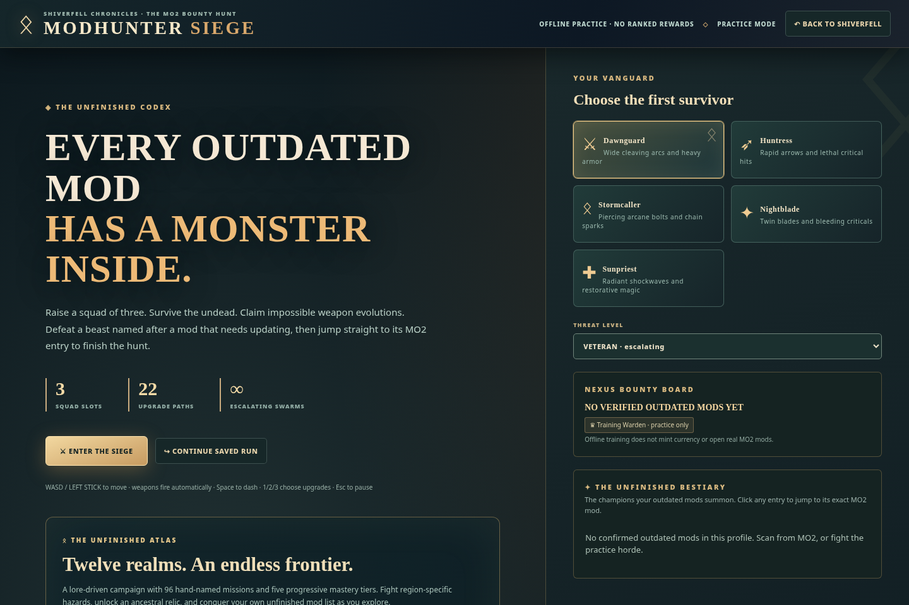

# ⚔ MODHUNTER · THE COMPLETE RELEASE VAULT

### From Skyrim Arsenal to Questbound, AetherFX, Shiverfell, Mythforge, Siege and Atlas

**[📦 Complete authentic archive (all eight milestones, every original plugin/source ZIP and GIF)](https://drive.google.com/file/d/1tQBnUZ_vDF7tUTtiXf8WJC41OEXNVG_5/view)** · **[JSON provenance manifest](https://drive.google.com/file/d/1KxVD8EZ92eIP0TpPNC1at3B8WnEOF7tR/view)** · **[Latest standalone HTML](https://github.com/Herbertofury/Modhunter/blob/main/web/Modhunter.html)**

The archive keeps **original outputs separate from the modern release**. No historical source archive or original preview is silently replaced by a recreation.

---

# Modhunter — Complete original output inventory and preservation audit

> **ALL 36 ORIGINAL OUTPUT FILES RECOVERED** · Eight release milestones · 16 historical source/plugin/desktop ZIPs · Four original GIFs · Two original PNG previews · Five original checksum manifests · Three later complete updater checkpoints.

This report corrects the prior incomplete audit: **the original GIFs and historical ZIPs WERE present on Google Drive**. Title search had missed them. We directly enumerated each versioned Drive folder, downloaded the original bytes, checked ZIP integrity, and verified every applicable original release-manifest hash.

**Scope:** The linked ChatGPT shared conversation cannot be fetched as a complete transcript with the available connection. This is a verified inventory of every file in the eight accessible versioned Drive release folders and three later updater ZIP checkpoints. It is not a claim to have read all messages in that inaccessible chat or all transitory chat-only attachments.

## Exact original outputs, release by release

| Version | Original release theme | Exact original file outputs | Integrity |
|---|---|---|---|
| **v0.1** | Skyrim 1.5.97 original | [Skyrim Mod Update Arsenal 1.5.97.html](https://drive.google.com/file/d/196Ox870E8wI7RVlVUVFChZOir4zmHDtE/view) (html) [Skyrim Mod Update Arsenal SOURCE.zip](https://drive.google.com/file/d/1UTs9WOZclWxlwcJyqqDstDxRIekw_mrH/view) (source) | 2 files; 0 original manifest hashes matched |
| **v0.2** | Live MO2 integration foundation | [MO2 Update Arsenal.html](https://drive.google.com/file/d/1J-bblRfZWKOMA5XrDAkOdCQtzO7SnrxK/view) (html) [MO2 Update Arsenal Plugin.zip](https://drive.google.com/file/d/1CgaMG0GmJ6QAMHg8o3zlibAj3tlkg98R/view) (plugin) [MO2 Update Arsenal Full Source.zip](https://drive.google.com/file/d/1iqctIc3alSsTNvQvEGk091SifMBCLa_r/view) (source) | 3 files; 0 original manifest hashes matched |
| **v0.3** | Questbound | [MO2 Update Arsenal Questbound.html](https://drive.google.com/file/d/1_hBAwMm2Zju3gc724gw4akNSIdNR2Qh9/view) (html) [MO2 Update Arsenal Questbound Plugin.zip](https://drive.google.com/file/d/1yB-tzkZzn8KpR234hatw2dF9ONZvF2-_/view) (plugin) [MO2 Update Arsenal Questbound Source.zip](https://drive.google.com/file/d/1Mm7AQt9-YYRLX3WF0Y7H4HqO2IPT3gJ9/view) (source) [Victory Preview.png](https://drive.google.com/file/d/1eLOBfDy7D45Z_v_9SHUd0A1JXhvbq8ik/view) (preview) | 4 files; 0 original manifest hashes matched |
| **v0.4** | AetherFX | [MO2 Update Arsenal AetherFX v0.4.html](https://drive.google.com/file/d/1BcJ7loXxMAtLdSxOQ93Z76W3FBaBWpte/view) (html) [MO2 Update Arsenal AetherFX Plugin v0.4.zip](https://drive.google.com/file/d/1wdhnWZSlc_W_oJFUYSWvInTntiNaL8QW/view) (plugin) [MO2 Update Arsenal AetherFX Source v0.4.zip](https://drive.google.com/file/d/10oj8afBpeIdN-ggRTTNcSAviOpLbBOv4/view) (source) [Glass Finisher Chromium Demo.gif](https://drive.google.com/file/d/14wafsQIlBoT4gCp5HJBNh8jWAN1x_lQQ/view) (preview) [Release Manifest.json](https://drive.google.com/file/d/1Qh5Z5CXKWF6xnezKbkH4JKY_7FF6Ctrq/view) (manifest) | 5 files; 3 original manifest hashes matched |
| **v0.5** | Shiverfell Chronicles | [MO2 Update Arsenal Shiverfell v0.5.html](https://drive.google.com/file/d/1C3YdePo9Dd3-ewoVouQwAYnrqajxwsFo/view) (html) [MO2 Update Arsenal Shiverfell Plugin v0.5.zip](https://drive.google.com/file/d/1TEz4zva5Rs9UzxAp33p-0rXTUpH9QzW-/view) (plugin) [MO2 Update Arsenal Shiverfell Source v0.5.zip](https://drive.google.com/file/d/1oZdgFHpbwjfApJfOas9n0bhR1lM5Hrzp/view) (source) [Shiverfell Gameplay Chromium.gif](https://drive.google.com/file/d/1zotxIK-s9s_LS-mImVNLX9uTP2ep_SEM/view) (preview) [Shiverfell v0.5 Manifest.json](https://drive.google.com/file/d/1EdEwp4BI46YvQehmC0b01oOpjwR6KLJ5/view) (manifest) | 5 files; 3 original manifest hashes matched |
| **v0.6** | Mythforge | [MO2 Update Arsenal Mythforge v0.6.html](https://drive.google.com/file/d/16xTa74HaUUmeUNLe6CrNq_Kvh-Kn9j7Q/view) (html) [MO2 Update Arsenal Mythforge Plugin v0.6.zip](https://drive.google.com/file/d/1FS8n705Qau_RJwjwWMBu0xZ2nH9Luoc7/view) (plugin) [MO2 Update Arsenal Mythforge Source v0.6.zip](https://drive.google.com/file/d/1X7fK2xvSJZqMT_5L_bfSAtMAVQqFQ8Vv/view) (source) [Mythforge Gameplay Chromium.gif](https://drive.google.com/file/d/1mdcLfPqdX2oy1lGNqoKntvoJsHKr9D1E/view) (preview) [Mythforge v0.6 Manifest.json](https://drive.google.com/file/d/1UbxjtPMag7rQe-5KtklbJgISyaFxArZi/view) (manifest) | 5 files; 3 original manifest hashes matched |
| **v0.7** | Modhunter Siege | [MO2 Update Arsenal Modhunter Siege v0.7.html](https://drive.google.com/file/d/16d2rFKu7Q2YLuyTk7-40joANAG5oUfiD/view) (html) [MO2 Update Arsenal Modhunter Plugin v0.7.zip](https://drive.google.com/file/d/1vHgqzen0YGaMrDBpMVvGyZhMJgBt9JeU/view) (plugin) [MO2 Update Arsenal Modhunter Source v0.7.zip](https://drive.google.com/file/d/16_2HoM1hEkYdDTf-Op1Um9odlUWncVh7/view) (source) [Modhunter Siege Gameplay Chromium.gif](https://drive.google.com/file/d/1nGCzzeqVYeu0bF9yqFp7VrKGc9fz7H83/view) (preview) [Modhunter Siege v0.7 Manifest.json](https://drive.google.com/file/d/1jFbtcWjoqJup2z3m-rnvQNIsaHAbXhqo/view) (manifest) | 5 files; 3 original manifest hashes matched |
| **v0.8** | Atlas and three editions (original baseline) | [Modhunter.html](https://drive.google.com/file/d/1gEEeYNAAT7cL_MSbPJQMZBkFoN2y2ZYf/view) (html) [Modhunter-MO2-Plugin.zip](https://drive.google.com/file/d/14rTBxwcAARuxkFY14TjR6XpQyiiknO0N/view) (plugin) [Modhunter-Desktop-Source.zip](https://drive.google.com/file/d/1jX1hfF8G-geo8vQKUdoLCId3H7NY_yu7/view) (desktop) [Modhunter-Complete-Source.zip](https://drive.google.com/file/d/1mgkYtOpyvAWRmAi7AhdiOMccMHwRahFI/view) (source) [README.md](https://drive.google.com/file/d/1gh11gveQ6mGH5ozsVEgbYY1_d4ROia4r/view) (readme) [manifest.json](https://drive.google.com/file/d/1Q492Y3N02sVFeYhzwKd_wlkgycWdmVwm/view) (manifest) [atlas-map.png](https://drive.google.com/file/d/11VN0qP-rmCQq7cxw0GCCW8uTuh2AIlB0/view) (preview) | 7 files; 4 original manifest hashes matched |

### Original media actually recovered

These are authentic GIF/PNG files downloaded from the original release folders. **They are not regenerated copies**.
- **v0.3** [Victory Preview.png](https://drive.google.com/file/d/1eLOBfDy7D45Z_v_9SHUd0A1JXhvbq8ik/view): original static preview, 1510×980 pixels, 1,132,042 bytes, SHA-256 `239b83dab17164c6a2dc7f60ad9b54f3c645c2f65f6b89a9838d2bff9845feb8`.
- **v0.4** [Glass Finisher Chromium Demo.gif](https://drive.google.com/file/d/14wafsQIlBoT4gCp5HJBNh8jWAN1x_lQQ/view): 8 frames, 895×303 pixels, 652,366 bytes, SHA-256 `0a889c6db6867f00835dbd848710968cb3b34b7c0ee6351fe15921132c59277b`.
- **v0.5** [Shiverfell Gameplay Chromium.gif](https://drive.google.com/file/d/1zotxIK-s9s_LS-mImVNLX9uTP2ep_SEM/view): 16 frames, 760×426 pixels, 765,560 bytes, SHA-256 `ac3d63aee3a1558a463d2717a4ec255f1b39834a7876deb43cb6082464a160cc`.
- **v0.6** [Mythforge Gameplay Chromium.gif](https://drive.google.com/file/d/1mdcLfPqdX2oy1lGNqoKntvoJsHKr9D1E/view): 16 frames, 760×426 pixels, 1,545,284 bytes, SHA-256 `9f9f4c6ca1417feb87716f2ffadc744646266797e30107668f1fe6bc415f8a65`.
- **v0.7** [Modhunter Siege Gameplay Chromium.gif](https://drive.google.com/file/d/1nGCzzeqVYeu0bF9yqFp7VrKGc9fz7H83/view): 12 frames, 1000×600 pixels, 3,447,221 bytes, SHA-256 `793950cc1805e6bf44af21adb313ffd52ccff0c0a21ffa5df287219ee4b298d6`.
- **v0.8** [atlas-map.png](https://drive.google.com/file/d/11VN0qP-rmCQq7cxw0GCCW8uTuh2AIlB0/view): original static preview, 1440×960 pixels, 715,027 bytes, SHA-256 `819ce2a05a6ca39502ec81946f38e7164cb132c4dd6aff69ce8646e692e9f353`.

## Features recovered from the linked project lineage

| Release | Preserve in current version | Evidence / verification |
|---|---|---|
| v0.1 Skyrim Arsenal | Original 227 Skyrim mods, 115 sections, 223 exact source links; update checklist, 1.5.97 warnings, persistence and export | Catalog content hash matches across all eight historical HTMLs and current build |
| v0.2 MO2 Update Arsenal | MO2 scanner, exact installed mod location, native Nexus download and safe interactive installation | Plugin and full-source ZIPs recovered exactly; current HTTP/API tests pass; native Windows acceptance unresolved |
| v0.3 Questbound | Mod maintenance as XP, rank, achievements, combos, verified full-clear World-Eater finale | Original Victory Preview.png recovered; quest browser QA passes |
| v0.4 AetherFX | Row-targeted glass shattering, 14 fragments, 7 themed effects, animation studio and reduced motion | Original Glass Finisher GIF recovered; AetherFX browser QA passes |
| v0.5 Shiverfell | Separate top-down persistent survival world, quests, crafting, companions, rifts, two roguelites and 10 earned Sigils/update | Original Shiverfell GIF recovered; realm QA passes |
| v0.6 Mythforge | Three Dawnshards, Ashen Warden persistent world boss, six talents, gamepad, day-night/weather | Original Mythforge GIF recovered; mythforge browser QA passes; historical manifest reports 1.7 to 1.1 ms median render (prior measurement, not rerun now) |
| v0.7 Siege | 3-member auto-attacking survivor squad, 22 upgrades, five hero classes, mod-specific bestiary and update bounties (100 boss Hunt Points, +200 verified bonus, 10 Sigils) | Original Siege GIF/source/plugin/manifest recovered; browser Siege QA passes |
| v0.8 Atlas | Three independent cooperating editions, 12 regions × 8 named contracts × five tiers (480 first clears), map, legacy perks, intended 80-hour base timer sum | Original v0.8 HTML, desktop, MO2 plugin, complete source, manifest, map recovered; Atlas QA passes |
| Latest updater expansion | Native MO2 Nexus login, GitHub/GitLab public release checks, per-file reviewed MO2 download queue, independent desktop import | Published source/docs plus 99 Python and 4 Node tests pass in CI; live Windows acceptance remains unverified |

### Source/parity findings

- **Previously authored DOM IDs missing from current HTML:** 0.
- **Previously named JS functions no longer present:** `drawBase`; the former Shiverfell `drawBase` entry point was superseded by newer renderer code, and gameplay browser QA passed.
- **Current HTML:** 579,406 bytes with 319 DOM IDs and 265 named JS functions.
- **All historical catalogs:** 227 installed mod rows, 115 group sections, 223 verified source links with identical content hashes.
- **Interpretation:** structural IDs and targeted browser tests support preservation, but do not prove every old effect behaves identically in every runtime.

## All later complete updater release checkpoints (preserved separately)

- [Modhunter-Update-Workshop-Complete.zip](https://drive.google.com/file/d/1wpXYSMmrnmtJCW-j6ypZrmWDPJOhuA2b/view), 7,444,567 bytes, SHA-256 `841bc3f78bd563047b26714fa5bc1635961226a28193de76b361c9f7e22856fd`.
- [Modhunter-Updater-v0.8-Expanded-Complete.zip](https://drive.google.com/file/d/1gbw_bLUoVVGcxCZrrGQMDm5TrWXq3kcB/view), 7,474,550 bytes, SHA-256 `7292e50aae710ae69e23f01d185b9cb0af0e96d968349772aeec3f0015508a70`.
- [Modhunter-Updater-Verified-Complete.zip](https://drive.google.com/file/d/1nn5vQIie4vjd2yIOVUl-MG_g212gJzLk/view), 7,496,910 bytes, SHA-256 `5ab8791d95c2fecd52e6b7b4b9b8cfa2175e2a50a26447582adeeda0da21dd9c`.

The final `Modhunter-Updater-Verified-Complete.zip` is the newest bundled source. Its standalone page is taken from its own embedded `dist/Modhunter.html`, **not** from the older v0.8 Drive file of the same name.

## Verification results

- **Original Drive folders:** 8 versioned release folders; all direct listings reached the end with no cursor. **36 original files** identified and downloaded.
- **ZIP integrity:** 16 original ZIP packages and all 3 later complete ZIPs passed `ZipFile.testzip()`; no duplicate paths.
- **Original release manifest proof:** 16 file sizes and SHA-256 digests matched across v0.4, v0.5, v0.6, v0.7 and v0.8.
- **Historical preview authenticity:** four original GIFs and two PNGs decoded successfully with Pillow; no substitutes.
- **Browser QA on current code (previous audit):** Questbound, AetherFX, Shiverfell, Mythforge, Siege, Atlas all passed targeted Chromium tests.
- **Current GitHub CI:** [Successful package + 99 Python and 4 desktop Node tests](https://github.com/Herbertofury/Modhunter/actions/runs/43137476465).
- **Native Windows MO2/Electron:** not yet verified; do not claim desktop EXE or real in-game installation proof.

## Exact archive layout

`original_releases/v0.1` through `original_releases/v0.8` contain **all 36 original Drive files**, with their original names and bytes, including all original GIFs and source/plugin ZIPs. `updater_checkpoints/` contains all three later complete archives. `current/` contains a canonical latest copy extracted from the final updater archive, `qa_evidence/` optionally includes regenerated test screenshots and preview captures, and the root contains this Markdown audit and a machine-readable JSON manifest with SHA-256 and Drive provenance for every file.

## Remaining boundary

The shared ChatGPT transcript was not directly readable, so ephemeral chat-only outputs that were never saved to these Drive folders cannot be declared recovered. What *is* fully reconciled here is **every actual artifact in all eight original version folders**, including the previously missed authentic historical binaries and GIFs. Current authenticated update support on private mod-provider websites and real Windows MO2 acceptance remain separate unfinished work.

**Repository:** https://github.com/Herbertofury/Modhunter · **Wiki:** https://github.com/Herbertofury/Modhunter/wiki · **CI:** https://github.com/Herbertofury/Modhunter/actions/runs/43137476465
