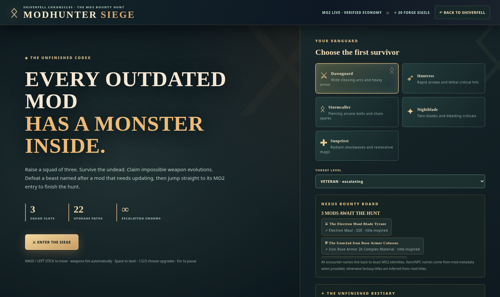
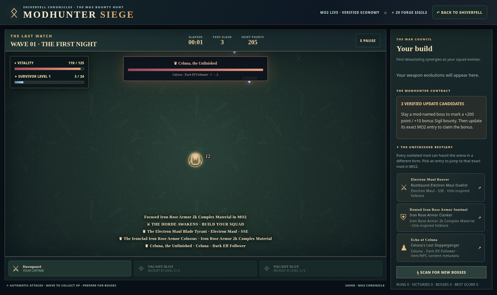

# 🐉 The Unfinished Bestiary
[Home](Home.md) / Bestiary

The bestiary translates unfinished mod-maintenance work into a fantasy enemy roster. Identified outdated mods become bounties, not automatically completed updates.

| Installed mod family | In-world identity |
| :-- | :-- |
| Followers | Named rivals and hunter champions |
| Weapons | Cursed wielders |
| Armor | Living colossi |
| Magic and spells | Arcane casters |
| Other outdated mods | Region-specific threats and contracts |

**Separate two events:** defeating a themed foe may award game-only points, while the greater verified maintenance bounty is earned only when MO2 detects and validates an actual update. This prevents game simulations from modifying real update history.
