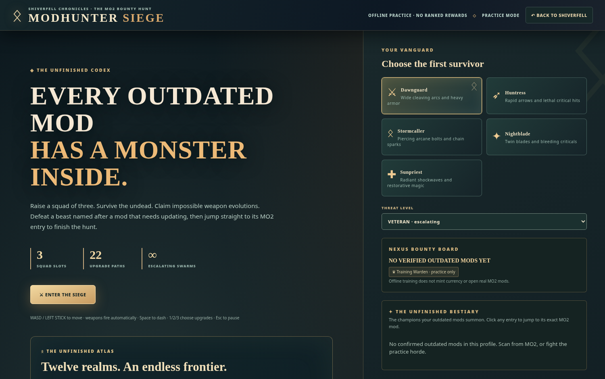

# ⚔ MODHUNTER · ONE UNIFIED COMMAND CENTER

**[Download the current Rust Windows release](https://github.com/Herbertofury/Modhunter/releases)** · [Installation and tested scope](Rust-Desktop.md)

The current portable package contains the Rust desktop, MO2 plugin, both native helpers and plugin installer. The [earlier Everything archive](https://drive.google.com/file/d/1UZzjHQQX3hceSWcJWFX2yygH6htzXqHE/view) preserves the Electron edition at its root (Modhunter.html, Desktop/, MO2/, Source/, Docs/) and all 36 original outputs under History/. Its 111 files were verified against that archive's manifest. Historical versions remain available for reference.

> **Primary purpose:** Keep your real Mod Organizer 2 mods up to date, with an elegant, traceable, profile-specific workflow. Questbound, AetherFX, Shiverfell, Mythforge, Modhunter Siege and the Atlas are all part of the **same product**, not separate replacement apps.

## One product. Three independent entry points.

| Entry point | Works by itself | Mod review | Live MO2 updating | World and game content |
|---|---|---|---|---|
| **Standalone HTML** | Yes, a self-contained HTML file | Complete offline checklist, search, source links, export | Not without MO2 connection; never fabricates update status | Questbound, AetherFX, Shiverfell/Mythforge, Siege/Atlas |
| **Rust Desktop App** | Yes, Windows and WebView2; no Node or Electron required | All offline features **plus** on-demand read-only MO2 modlist import | Find MO2 discovers and validates the plugin's tokenized loopback session | Same HTML, native tabs for mods, Siege, Shiverfell |
| **MO2 Python Tool** | Yes, when loaded by MO2 | Actual active profile, installed versions, exact Nexus IDs, active game runtime | Nexus and public release checks; MO2 downloads, interactive installs, backups, rescan | Same bundled HTML, verified Forge Sigils and actual mod-based bosses |

All three editions ship the **same byte-for-byte self-contained dashboard**. Desktop never needs the MO2 plugin to play games or inspect an imported portable profile. The MO2 plugin never needs the desktop app to serve its live dashboard. Standalone HTML requires neither to launch.

## Command Center navigation

The shared landing page now has four coordinated operations:

1. **Update every MO2 mod** — the primary mission, with the live or offline mode explicitly marked. In MO2, **Check all mod sources** runs Nexus and supported public release checks. The Workshop sorts every installed mod into update candidates, manual/unlinked, needs verification and current. It provides exact file review and a safe reviewed download queue.
2. **Questbound + AetherFX** — update achievements, actual install-verified rewards, rank, dramatic finishers and the adjustable FX Studio.
3. **Shiverfell + Mythforge** — persistent survival, exploration, weather, crafting, Dawnshard story and Ashen Warden.
4. **Modhunter Siege + Atlas** — survivor squad, mod-sourced enemies, Unfinished Bestiary, 12 campaign regions, 96 contracts and five mastery tiers.

The worlds and effects must **never interrupt, replace, fake or prioritize themselves ahead of** real MO2 update tasks. No artificial row caps, sample-only overlays in live mode, silent updates or fabricated verified achievements.

## Recommended Windows setup

1. Download **Modhunter-Rust-Windows.zip** from [Windows releases](https://github.com/Herbertofury/Modhunter/releases) and extract it to a permanent folder. An NSIS installer is also available for the desktop app.
2. Run **Modhunter.exe**. Use **Import MO2** to inspect a local profile without the plugin; select its `modlist.txt`, with optional instance INI and mods-path overrides for custom layouts.
3. For live updates, close MO2 and run the portable package's **Install_MO2_Plugin.bat**. Select the folder containing `ModOrganizer.exe`, restart MO2 and launch **Tools → Update Arsenal - Quest Board**. The installer preserves previous plugin data and a backup. Native integration is tested against official **MO2 2.5.2**.
4. Click **Find MO2** in the Rust app to connect a validated running session. Multiple sessions are offered for selection. The plugin's browser dashboard also works independently.
5. For browser-only offline use, open the current [standalone HTML](https://github.com/Herbertofury/Modhunter/blob/main/web/Modhunter.html). Games and the checklist do not require MO2; live updating requires the plugin.

The Rust portable package includes `BUILD_INFO.json`, `SHA256SUMS.txt` and Windows smoke evidence. The release also supplies a verification archive. The older [All-in-One archive](https://github.com/Herbertofury/Modhunter/blob/main/dist/Modhunter-All-in-One.zip) retains its historical **Installers/**, **Source/**, **Docs/** and **bundle-index.json**; use the current release above for the new helpers and source adapters.

## Actual updater workflow

**Inspect actual profile → identify each original source → query real version evidence → review exact compatible files → queue approved downloads to MO2 → install interactively → backup and re-scan.**

- **Nexus Mods:** MO2's own Nexus authorization when the bridge is available, exact project/file IDs, selected archive in MO2 Downloads.
- **GitHub, GitLab, Modrinth and Thunderstore:** exact project/release/file comparisons, declared dependency and compatibility context, and eligible archive selection through MO2. Published hashes are metadata; they do not claim independent verification of downloaded bytes.
- **Patreon, LoversLab, Mod DB, Bethesda Creations and other gated sources:** retained original URLs, manual-review states until a provider-authenticated, reliable check is implemented. Never display “current” without evidence.
- **Compatibility:** target game executable and SKSE runtime, native DLLs, FOMOD options, hard masters, dependency order, behavior generators and save warnings.
- **Updates:** an unambiguous, freshly validated file can use **Update now**; ambiguous or risky choices open the file picker. Batch review and installation briefings remain available. Profile backups cover load-order text files, and MO2 keeps its interactive FOMOD and overwrite choices.

For the exact coverage matrix and unsupported providers, see [Updater Source Coverage](Updater-Source-Coverage.md) and [Update Workshop](Update-Workshop.md).

## Preservation of all historical outputs

The v0.1 through v0.8 lineage is **merged functionally** into the current application, while the **36 authentic original outputs** remain separately preserved (including original ZIPs, GIFs, screenshots and manifests) instead of being rewritten. See [Original Releases and Full Output Audit](Original-Releases-and-Output-Audit.md) and the [original archive on Google Drive](https://drive.google.com/file/d/1tQBnUZ_vDF7tUTtiXf8WJC41OEXNVG_5/view).

## Verification boundary

The Rust workflow checks the core, Python bridge, source adapters, browser interactions, actual Windows WebView2 app and a portable official MO2 2.5.2 fixture. Release validation binds the packages to those build receipts and checks the shipped production files and native helpers. The fixture does not authenticate a Nexus account or prove account-specific downloads, FOMOD choices, private-site access or a particular game setup. Exact run evidence is linked from [Rust Desktop](Rust-Desktop.md).

**Next:** [Getting Started](Getting-Started.md) · [Rust Desktop](Rust-Desktop.md) · [MO2 Plugin](MO2-Plugin.md) · [All Original Releases](Original-Releases-and-Output-Audit.md).
