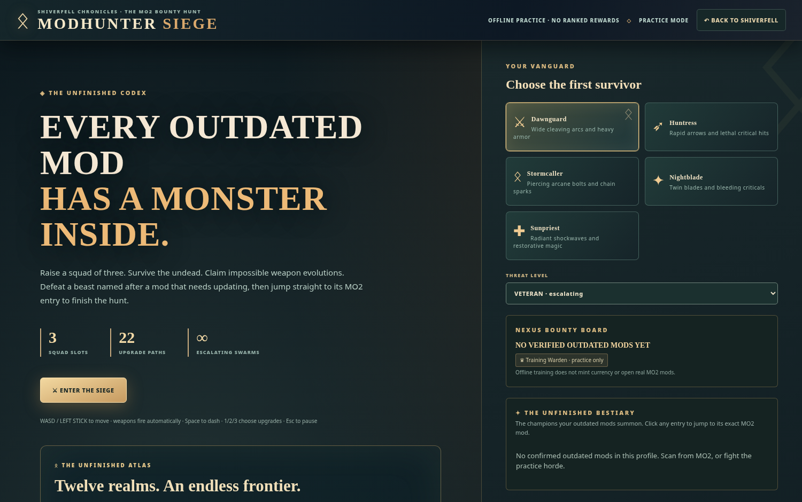

# ✦ Modhunter Source Intelligence

> **Verified evidence before update claims.** Every installed MO2 mod remains represented in the vault. A source link by itself is not proof of an available, compatible update.

## Source coverage, by provider

| Source | Identify original project | Automatically check version | Send selected archive to MO2 |
| :--- | :---: | :---: | :---: |
| **Nexus Mods** | MO2 native project ID and mod URL | **Yes:** full audit via MO2's existing Nexus bridge; optional in-memory API key fallback | **Yes:** choose verified file ID, native MO2 download manager |
| **GitHub releases** | MO2 mod URL, meta.ini, notes, saved link | **Yes:** public latest-release API, version-tag comparison | **Yes:** choose actual release ZIP/7z/RAR asset, native MO2 URL download |
| **GitLab releases** | Public project link | **Yes:** public latest-release API | Manual file selection / source page |
| **Patreon** | MO2 saved project/post URL | **Not automatically verified** | Open original page with your signed-in browser |
| **LoversLab** | Existing source URL | **Not automatically verified** | Original Downloads page, then normal MO2 install |
| **Mod DB** | Existing source URL | **Not automatically verified** | Original Downloads page, then normal MO2 install |
| **Bethesda Creations / Creation Club** | Existing source URL | **Not automatically verified** | Official Creations installation path |
| **CurseForge / Modrinth / Thunderstore** | Existing source URL | **Not automatically verified** | Original provider downloads and regular MO2 install |
| **Modding Guild / Dwemer Mods** | Existing source URL | **Not automatically verified** | Signed-in page, manual file selection |
| **Boosty / Ko-fi / arbitrary sites** | Existing source URL | **Not automatically verified** | Signed-in page, manual file selection |
| **Manually installed / unlinked** | Retained as dedicated lane | **Unknown** until exact source linked | Add source in inspector, then check again |

All source links are **provenance labels**, not authentication claims. The app never promises to inspect a private Patreon, LoversLab or other account session. For those sources it retains the exact URL, reports **Unverified**, and opens the correct page.

## Independent desktop mode

**⌁ Import MO2** in the Electron top bar opens a native file picker. Select `profiles/<name>/modlist.txt`. The app reads the corresponding `mods/<mod>/meta.ini` files on demand to build a real read-only vault, retaining disabled/unlisted mods, sources, installed versions and DLL warnings. This does **not** require the plugin, Node integration in the web content, Nexus credentials or background monitoring. It does **not** remotely verify updates or install archives; use the plugin for those actions. Re-import to refresh.

## Where source identities come from

Modhunter inspects, in order, the mod's own **MO2 URL field**, its mod directory's limited `meta.ini`, notes, and the explicit original URL you save in Modhunter's inspector. Where no other link exists and MO2 provides a real Nexus mod ID, the official Nexus project Files URL is constructed. A mod without a source remains **Unlinked** rather than guessed by title.

Source URLs are normalized to HTTPS and stripped of query credentials and tracking parameters. Each saved manual link is scoped to the MO2 profile, and its previous update verdict is invalidated when the source changes.

## Exact update procedure

1. Launch **Tools → Update Arsenal - Quest Board** inside MO2.
2. In MO2 **Settings → Nexus**, sign in using MO2's own official connection. Modhunter's native Nexus gateway reuses this connection to request metadata and file lists, without asking for a separate API key. A personal key remains an optional fallback on builds without the native bridge.
3. Click **✧ Check all mod sources**. Full Nexus audit checks all linked Nexus projects; public GitHub and GitLab release APIs are checked; unsupported or gated sources stay **Unverified**.
4. Open **The Update Workshop**. Filter candidates, manual/unlinked, current, and investigation lanes. No record cap or disappearing rows.
5. On a candidate choose **Review files**. Select the exact Nexus file or GitHub release asset and review the target game/runtime, native DLL requirements, plugin masters, FOMOD options and project changelog.
6. Click **Queue reviewed files**. The server validates every selected file and source association **before downloading any of them**. Then MO2's own native download manager handles Nexus or vetted GitHub links. Duplicate exact file IDs are deduplicated. No mod files are replaced just by queueing.
7. When a download completes choose **Install with MO2**. Modhunter first saves a timestamped text backup of profile/load-order state; MO2's interactive installer owns FOMOD and overwrite decisions.
8. Verify enabled state, conflicts, and in-game stability. Refresh the profile and run a deep Nexus check to confirm current version evidence and verified update rewards.

### Meaning of update states

- **Candidate:** a reliable project version or public release tag compares newer than installed metadata, **not** proof the file is safe for your runtime.
- **Current:** fresh source evidence says the installed version is at or above latest; cached/local checks are explicitly identified by their metadata origin.
- **Review:** conflicting or incomparable version strings, potentially risky requirements, or a source that needs human investigation.
- **Unverified:** source could not be checked automatically, account gated, missing metadata, or external API failed. Never secretly promoted to “current”.
- **Partial audit:** one or more provider checks failed. Successful records remain available, with explicit errors for the rest.

## Limits and safeguards

- Native **Windows MO2** signal wiring, account permissions and genuine FOMOD installations still require acceptance tests on a real installed MO2 instance. GitHub CI tests use a faithful mocked MO2 bridge plus real Python HTTP handlers. Do not treat those as native Windows proof.
- MO2 file-choice metadata does not automatically resolve dependency order or install the correct FOMOD options.
- GitHub releases can change assets; file selection is validated against Modhunter's server-owned release record before dispatch. Private, deleted, or non-archive releases remain manual.
- A backup of `modlist.txt`, `plugins.txt` and related load-order files is **not** a complete copy of mod files or save games.
- Manual update checks run only when requested; there is no default background website scraping or scheduled watchdog.

**Continue:** [Update Workshop](Update-Workshop.md) · [MO2 Plugin](MO2-Plugin.md) · [Compatibility & Safety](Compatibility-and-Safety.md) · [Troubleshooting](Troubleshooting.md).